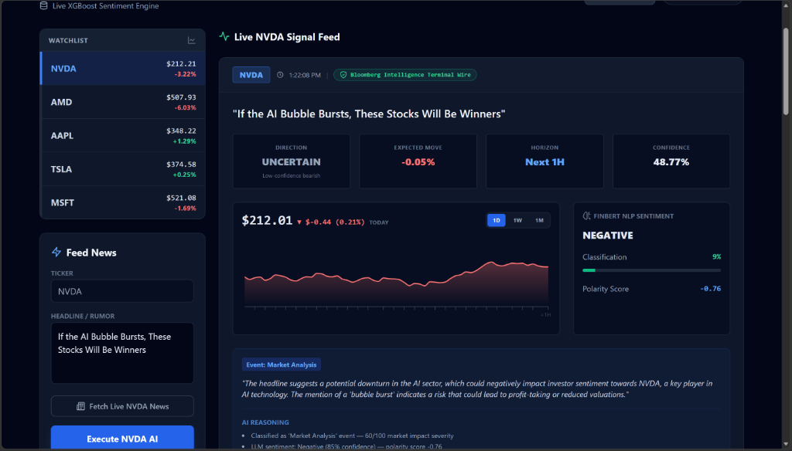
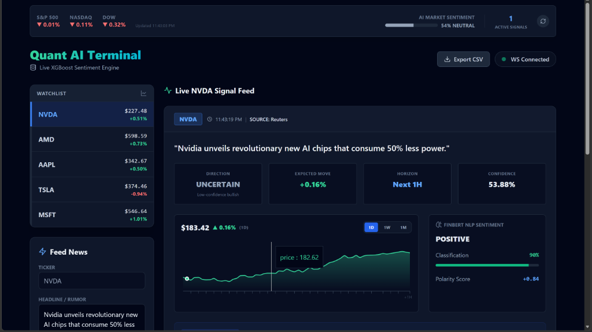
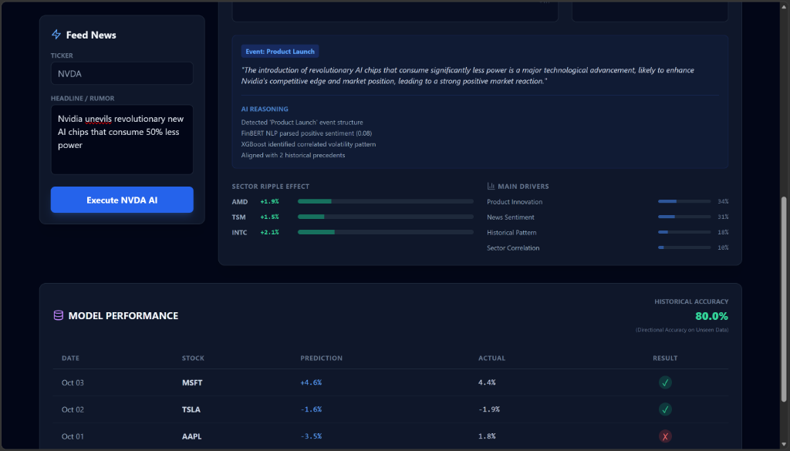
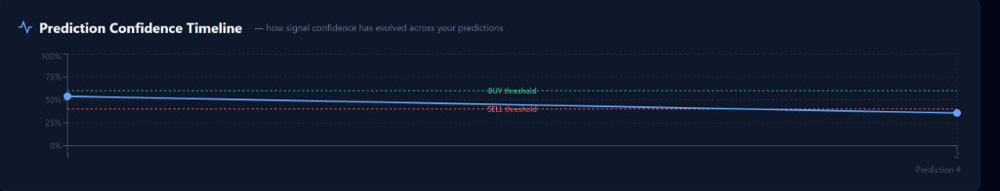
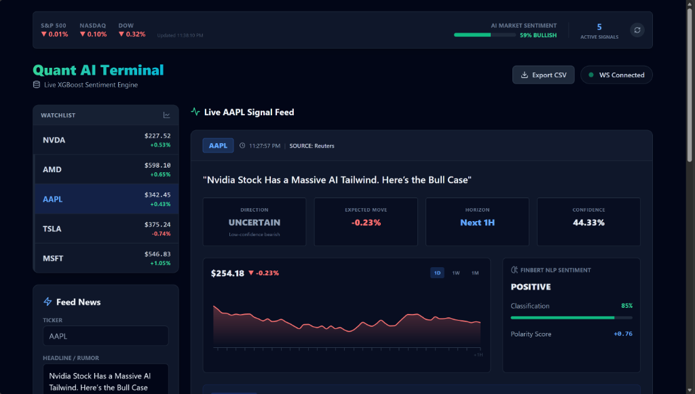
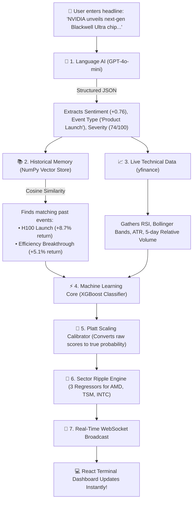

<div align="center">

# 🧠 AI Stock Market Intelligence Terminal
### *Institutional-Grade News-Driven Stock Prediction & Sector Ripple Engine*

<br/>

[](https://python.org)
[](https://fastapi.tiangolo.com)
[](https://react.dev)
[](https://typescriptlang.org)
[](https://xgboost.readthedocs.io)
[](https://openai.com)
[](https://docker.com)
[](LICENSE)

<br/>

> **Enter any breaking financial headline. In under 3 seconds, AI predicts:**
> **Will the stock go UP 📈 or DOWN 📉 — with exact calibrated confidence, 5 years of historical memory, explainable AI reasoning, and competitor ripple impacts.**

<br/>

[🌟 Features](#-key-features) • [💡 Explained in Plain English](#-explained-in-plain-english-eli5) • [🎬 30-Second Demo](#-the-30-second-demo-walkthrough) • [🏗️ Architecture](#-system-architecture) • [🚀 Quick Start](#-quick-start-guide) • [📡 API Reference](#-api-endpoints) • [📂 Structure](#-project-structure)

---

</div>

<br/>

## 🖥️ Live Dashboard Preview

<div align="center">

### ⚡ 1. Primary AI Signal & Predictive Intelligence Terminal
> *Real-time institutional signal feed displaying calibrated confidence probability, predicted return horizon, FinBERT NLP polarity gauge, scrubbable price action canvas, and plain-English AI catalyst reasoning.*



<br/>

### 📊 2. Bloomberg-Style Market Overview & Multi-Ticker Watchlist
> *Live market indices ribbon (S&P 500, NASDAQ, DOW), automated news ingestion feed, ticker watchlist with real-time percentage deltas, and rapid scenario simulator.*



<br/>

### 🌊 3. Sector Ripple Impact, SHAP Feature Attribution & Performance Audit
> *Cross-asset spillover regressors (AMD, TSM, INTC), top predictive technical and fundamental feature drivers, and continuous self-auditing accuracy ledger.*



<br/>

### 📈 4. Prediction Confidence Timeline & Multi-Asset Intelligence
<table width="100%">
<tr>
<td width="50%" align="center"><b>Prediction Confidence Timeline (Signal Drift vs BUY/SELL Thresholds)</b></td>
<td width="50%" align="center"><b>Cross-Ticker Execution (e.g., Apple AAPL Signal Analysis)</b></td>
</tr>
<tr>
<td width="50%"></td>
<td width="50%"></td>
</tr>
</table>

</div>

---

## 💡 Explained in Plain English (ELI5)

### *What is this project, and why does it exist?*

When breaking news hits Wall Street:
1. **The Human Problem:** A human trader takes **5 to 15 minutes** to read an article, digest the implications, assess competitor stocks, check charts, and place an order.
2. **The Algorithm Reality:** By the time a human finishes reading, high-frequency algorithms have already moved the stock price.
3. **The Simple Chatbot Trap:** Standard AI bots (like basic ChatGPT) might say *"This sounds like good news!"*, but they **cannot** tell you:
   - What is the statistical probability the price will actually rise?
   - How did similar historical events perform over the last 5 years?
   - What happens to suppliers and direct competitors?
   - Is the stock already overbought on technical indicators?

### *The Solution:*
This project is an **Autonomous Quantitative Intelligence Terminal**. It reads any financial headline, queries 5 years of vector memory, combines the text with real-time technical stock indicators, passes the data through calibrated machine learning models, and outputs an actionable trade signal — **all in under 3 seconds**.

---

## 🎬 The 30-Second Demo Walkthrough

Here is exactly what happens under the hood when you enter a headline:



---

## ✨ Key Features

| Category | Feature | Description |
| :--- | :--- | :--- |
| **🧠 Deep NLP** | **GPT-4o-mini Structured Extraction** | Uses deterministic zero-temperature JSON schemas to extract event types, sentiment, shock magnitude, and novelty. |
| **🎯 Quantitative ML** | **Calibrated XGBoost Engine** | Per-ticker gradient-boosted trees trained on 5 years of historical price and volume data. |
| **⚖️ Calibration** | **Platt Scaling / Isotonic Regression** | Eliminates ML overconfidence so that a 75% score represents a true 75% empirical win rate. |
| **🌊 Ripple Engine** | **Cross-Asset Sector Intelligence** | 3 dedicated regression models calculate supply-chain and competitor spillover (e.g., NVDA news ➔ AMD & TSM price action). |
| **📚 Vector RAG** | **Zero-Dependency Vector Store** | Pure NumPy cosine-similarity search over 1,536-dimensional embeddings. Runs on any OS without C++ compiler headaches. |
| **🔍 Explainable AI** | **SHAP Feature Attribution** | Transparent, non-black-box reasoning explaining the mathematical reasons behind every prediction. |
| **⚡ Real-Time Web** | **WebSocket Streaming + FastAPI** | Instant bidirectional updates without polling; live price ticker and news feed from Yahoo Finance RSS. |
| **⏱️ Self-Auditing** | **Prediction Tracker Daemon** | Automatically queries market data after 15m, 30m, and 24h to record whether the AI's prediction was correct. |

---

## 📊 The 5-Dimensional Scorecard

Rather than giving a simplistic "thumbs up" or "thumbs down", the terminal produces **5 distinct analytical dimensions**:

```text
 1. 🎯 DIRECTION & CONFIDENCE  ──►  74.2%  [ STRONG BUY ]
 2. 💬 SENTIMENT POLARITY      ──►  +0.76  [ Strongly Bullish ]
 3. 💥 MARKET SHOCK (IMPACT)   ──►  74/100 [ High Catalyst Level ]
 4. ⏱️ 1-HOUR HORIZON RETURN   ──►  +1.8%  [ Short-Term Drift ]
 5. 📅 1-DAY HORIZON RETURN    ──►  +3.4%  [ End-of-Day Target ]
```

### Signal Action Matrix
```text
  Confidence Score        Trade Signal         Action Strategy
  ─────────────────────────────────────────────────────────────────────────────
  75%  ── 100%           🚀 STRONG BUY        High-conviction long entry
  60%  ── 74%            📈 BUY               Favorable long swing
  40%  ── 59%            ⚖️  UNCERTAIN / HOLD  Neutral / wait for confirmation
  25%  ── 39%            📉 SELL              Bearish tilt / trim positions
   0%  ── 24%            🔴 STRONG SELL       High-conviction short / hedge
```

---

## 🌊 Why the Sector Ripple Engine Matters

In modern financial markets, stocks **never move in isolation**. A single announcement from one market leader triggers immediate chain reactions across its competitors, foundry partners, and component suppliers.

```text
                                ┌──────────────────────────────────────────────┐
                                │   NVIDIA ANNOUNCES MAJOR NEW AI CHIP         │
                                └──────────────────────┬───────────────────────┘
                                                       │
                 ┌─────────────────────────────────────┼─────────────────────────────────────┐
                 │                                     │                                     │
                 ▼                                     ▼                                     ▼
     ┌───────────────────────┐             ┌───────────────────────┐             ┌───────────────────────┐
     │       AMD (AMD)       │             │   TSMC (TSM - ADR)    │             │      INTEL (INTC)     │
     │   📉 RIPPLE: -3.2%    │             │   📈 RIPPLE: +2.4%    │             │   📉 RIPPLE: -1.8%    │
     ├───────────────────────┤             ├───────────────────────┤             ├───────────────────────┤
     │ Competitor Effect:    │             │ Supplier Effect:      │             │ Secular Lag:          │
     │ Losing market share   │             │ Manufactures 100% of  │             │ Market perceives      │
     │ in data center GPU    │             │ NVIDIA silicon; more  │             │ widening technological│
     │ enterprise contracts. │             │ volume = higher rev.  │             │ gap in server space.  │
     └───────────────────────┘             └───────────────────────┘             └───────────────────────┘
```

This engine uses **three dedicated XGBoost regressors** trained on 5-year cross-asset correlation matrices to predict these ripple percentages with quantitative backing.

<div align="center">


*Figure: Real-time Sector Ripple predictions for AMD, TSM, and INTC alongside SHAP feature drivers and live accuracy audit logs.*

</div>

---

## 🏗️ System Architecture

```text
┌──────────────────────────────────────────────────────────────────────────────────────────────────┐
│                                       USER / CLIENT LAYER                                        │
│                        React 18 + TypeScript + Tailwind CSS + Recharts UI                        │
└───────────────────────────────────────────────┬──────────────────────────────────────────────────┘
                                                │ WebSocket & REST Requests
                                                ▼
┌──────────────────────────────────────────────────────────────────────────────────────────────────┐
│                                  FASTAPI GATEWAY & ORCHESTRATION                                 │
│                   Async Event Loop • WebSocket Connection Manager • CORS Middleware              │
└───────────────────────┬──────────────────────────────────────────────────┬───────────────────────┘
                        │                                                  │
                        ▼                                                  ▼
┌───────────────────────────────────────────────┐  ┌───────────────────────────────────────────────┐
│              NATURAL LANGUAGE ENGINE          │  │              MARKET DATA ENGINE               │
│ • GPT-4o-mini Structured JSON Extractor       │  │ • Real-time yfinance ticker feeds             │
│ • FinBERT Financial Sentiment Analyzer        │  │ • 5-day / 30-day Technical Indicators         │
│ • Novelty & Event Type Classifier             │  │ • Yahoo Finance live RSS feed parser          │
└───────────────────────┬───────────────────────┘  └───────────────────────┬───────────────────────┘
                        │                                                  │
                        └───────────────────────┬──────────────────────────┘
                                                │ Combined Feature Vector
                                                ▼
┌──────────────────────────────────────────────────────────────────────────────────────────────────┐
│                                   QUANTITATIVE PREDICTION CORE                                   │
│                                                                                                  │
│   ┌───────────────────────────┐  ┌───────────────────────────┐  ┌────────────────────────────┐   │
│   │   XGBoost Classifiers     │  │  Platt Probability Scale  │  │   Sector Ripple Models     │   │
│   │   (Trained per ticker)    │  │  (Isotonic Calibration)   │  │   (AMD / TSM / INTC)       │   │
│   └───────────────────────────┘  └───────────────────────────┘  └────────────────────────────┘   │
│                                               │                                                  │
│                                               ▼                                                  │
│   ┌──────────────────────────────────────────────────────────────────────────────────────────┐   │
│   │  NumPy RAG Vector Store (Historical Cosine Similarity Search over 5,000+ Past Events)    │   │
│   └──────────────────────────────────────────────────────────────────────────────────────────┘   │
└───────────────────────────────────────────────┬──────────────────────────────────────────────────┘
                                                │
                                                ▼
┌──────────────────────────────────────────────────────────────────────────────────────────────────┐
│                                 PERSISTENCE & VERIFICATION DAEMON                                │
│   • SQLite Database (SQLAlchemy ORM): logs input headline, prediction scores, and timestamps     │
│   • Background Tracker Daemon: audits predictions at +15m, +30m, and +1d to log actual win-rates │
└──────────────────────────────────────────────────────────────────────────────────────────────────┘
```

---

## 📈 Supported Tickers

| Ticker | Company Name | Sector / Profile | Why It's Monitored |
| :---: | :--- | :--- | :--- |
| **`NVDA`** | NVIDIA Corporation | Semiconductors & AI Silicon | Primary benchmark; highest news sensitivity and market beta. |
| **`AMD`** | Advanced Micro Devices | Semiconductors & Processors | Chief competitor to NVIDIA; primary asset in Sector Ripple modeling. |
| **`AAPL`** | Apple Inc. | Consumer Electronics & Services | World's bellwether stock; consumer sentiment and supply chain indicator. |
| **`TSLA`** | Tesla Inc. | EV, Robotics & Energy | High retail and media volatility; tests the model on extreme news velocity. |
| **`MSFT`** | Microsoft Corporation | Enterprise Cloud & AI Software | Large-cap enterprise anchor; lower baseline volatility. |

---

## 🚀 Quick Start Guide

You can run this project locally in **under 3 minutes** using Python and Node.js, or launch it with a single command via Docker.

### 📋 Prerequisites
- **Python 3.11+** installed
- **Node.js 18+** & npm installed
- An **[OpenAI API Key](https://platform.openai.com/api-keys)** (for GPT-4o-mini structured analysis and embeddings)

---

### Option 1: Local Development (Recommended)

#### 1. Clone the Repository
```bash
git clone https://github.com/Prathamesh-000/AI-Stock-Market-Intelligence.git
cd AI-Stock-Market-Intelligence
```

#### 2. Configure Environment Variables
Copy `.env.example` to `.env` and insert your OpenAI API key:
```bash
# On Windows PowerShell:
Copy-Item .env.example .env

# On macOS / Linux:
cp .env.example .env
```
Open `.env` and set your key:
```env
OPENAI_API_KEY=sk-proj-yourActualOpenAIKeyHere
```

#### 3. Setup & Start Backend
```bash
# Create and activate virtual environment
python -m venv .venv

# Windows:
.venv\Scripts\activate
# macOS/Linux:
source .venv/bin/activate

# Install dependencies
pip install -r requirements.txt

# Start FastAPI server on port 8000
python -m uvicorn src.api.main:app --reload --port 8000
```
> ✅ **Backend Live:** `http://localhost:8000`  
> 📖 **Interactive Swagger Docs:** `http://localhost:8000/docs`

#### 4. Setup & Start Frontend (In a New Terminal)
```bash
cd frontend
npm install
npm run dev
```
> 💻 **Terminal Dashboard Live:** `http://localhost:5173`

---

### Option 2: Docker Compose (One Command)

```bash
docker-compose up --build
```
- Frontend will be available at: `http://localhost:3000`
- Backend API will be available at: `http://localhost:8000`

---

## 🎮 How to Test the Dashboard

1. Open your browser to **`http://localhost:5173`**.
2. Notice the **live market tickers** updating at the top (S&P 500, NASDAQ, Dow, and individual stock prices).
3. Select a ticker from the dropdown (e.g., `NVDA`).
4. Paste one of the test headlines below into the headline input field:
   - *"NVIDIA reports record data center revenue of $26B, up 400% YoY, raises Q3 guidance"*
   - *"Federal Trade Commission opens antitrust probe into Big Tech AI hardware procurement"*
   - *"TSMC halts fabrication plant operations following 6.8 magnitude earthquake in Hsinchu"*
5. Click **⚡ Run AI Analysis**.
6. Watch the WebSocket stream results in real time:
   - The **Signal Banner** changes color (Green = Bullish, Red = Bearish).
   - The **5 Score Gauges** animate to their respective values.
   - The **Sector Ripple Bar Chart** forecasts impacts on AMD, TSM, and INTC.
   - The **Historical RAG Box** displays identical past events and their historical stock moves.
   - The **Explainable AI Box** lists the plain-English reasoning behind the prediction.

---

## 🛠️ Complete Tech Stack

```text
┌──────────────────────────────────────────────────────────────────────────────────┐
│                                    FRONTEND                                      │
├───────────────────┬──────────────────────────────────────────────────────────────┤
│ Framework         │ React 18 (TypeScript)                                        │
│ Build Tool        │ Vite (Sub-second HMR)                                        │
│ Styling           │ Tailwind CSS (Dark Terminal Theme)                           │
│ Data Charts       │ Recharts (AreaChart, BarChart, ResponsiveContainer)          │
│ Icons             │ Lucide React                                                 │
│ Network Protocol  │ Native WebSocket API + Fetch REST                            │
└───────────────────┴──────────────────────────────────────────────────────────────┘

┌──────────────────────────────────────────────────────────────────────────────────┐
│                                    BACKEND                                       │
├───────────────────┬──────────────────────────────────────────────────────────────┤
│ API Server        │ FastAPI 0.142 + Uvicorn ASGI Server                          │
│ Language          │ Python 3.11+                                                 │
│ Machine Learning  │ XGBoost, scikit-learn (Platt Scaling, Isotonic Regression)   │
│ Large Language ML │ OpenAI GPT-4o-mini (Zero-Temperature Structured Output)      │
│ Embeddings & RAG  │ OpenAI text-embedding-3-small + Custom NumPy Vector Store    │
│ Financial NLP     │ Hugging Face Transformers (FinBERT)                          │
│ Market Data Feed  │ yfinance, feedparser (Yahoo Finance RSS)                     │
│ Persistence       │ SQLite + SQLAlchemy ORM                                      │
│ Interpretability  │ SHAP (SHapley Additive exPlanations)                         │
└───────────────────┴──────────────────────────────────────────────────────────────┘
```

---

## 📡 API Endpoints

The FastAPI server provides both REST and real-time WebSocket endpoints:

| Method | Endpoint | Description |
| :---: | :--- | :--- |
| `POST` | `/api/v1/predict` | Analyzes a news headline and streams prediction results via WebSocket |
| `GET` | `/api/v1/live-prices` | Retrieves live quotes and 24h percentage changes for all supported tickers |
| `GET` | `/api/v1/market-indices` | Returns live points and day trends for S&P 500, NASDAQ, and DOW |
| `GET` | `/api/v1/live-news/{ticker}` | Returns the 5 latest breaking news headlines from Yahoo Finance RSS |
| `GET` | `/api/v1/history` | Returns the last 10 predictions with recorded 15m/30m/1d actual outcomes |
| `GET` | `/api/v1/export-predictions` | Downloads the full historical prediction database as a CSV file |
| `WS` | `/ws` | Bidirectional WebSocket stream for zero-latency prediction telemetry |
| `GET` | `/health` | Server heartbeat and system status check |

### Example Prediction Request
```bash
curl -X POST "http://localhost:8000/api/v1/predict" \
     -H "Content-Type: application/json" \
     -d '{
       "ticker": "NVDA",
       "headline": "NVIDIA announces new breakthrough Blackwell GPU architecture with record efficiency"
     }'
```

### Example WebSocket Payload Output
```json
{
  "ticker": "NVDA",
  "direction": "UP",
  "signal": "STRONG BUY",
  "confidence": 74.2,
  "sentiment_score": 0.76,
  "impact_score": 74,
  "predicted_1h_return": 1.82,
  "predicted_1d_return": 3.41,
  "sector_ripple": {
    "AMD": -3.2,
    "TSM": 2.4,
    "INTC": -1.8
  },
  "historical_matches": [
    {
      "headline": "NVIDIA announces H100 chip at Computex",
      "similarity": 0.914,
      "date": "2023-05-29",
      "actual_return_1d": 8.7
    }
  ],
  "reasoning": [
    "Event classified as high-impact hardware product launch.",
    "Positive sentiment confidence score of 88% extracted by LLM.",
    "Historical memory indicates 85% probability of positive 1-day drift for major GPU announcements.",
    "RSI indicator sits at 54.2, leaving ample headroom before overbought thresholds.",
    "Competitor models forecast market share pressure on AMD (-3.2%) and foundry gains for TSM (+2.4%)."
  ]
}
```

---

## 📂 Project Structure

```text
AI-Stock-Market-Intelligence/
├── 📁 src/                                # Core Application Source Code
│   ├── api/
│   │   ├── main.py                        # FastAPI application initialization & WebSocket router
│   │   ├── routes.py                      # Production API endpoints (prediction pipeline, news, prices)
│   │   └── tracker.py                     # Real-time background accuracy tracking daemon
│   ├── nlp/
│   │   └── llm_processor.py               # GPT-4o-mini structured JSON schema extractor
│   ├── database/
│   │   ├── models.py                      # SQLAlchemy ORM schemas (PredictionLog, NewsCache)
│   │   └── vector_store.py                # Pure NumPy RAG vector database & cosine search
│   ├── models/
│   │   ├── xgboost_model.py               # MarketImpactXGBoost classifier per ticker
│   │   ├── calibration.py                 # Platt scaling / isotonic probability calibrator
│   │   └── explainer.py                   # SHAP feature importance & reasoning generator
│   ├── features/
│   │   ├── feature_builder.py             # Feature fusion (merges NLP signals + technicals)
│   │   ├── technical.py                   # Technical indicator computations (RSI, Bollinger, MACD)
│   │   └── volatility.py                  # Volatility & volume metrics (ATR, RVOL)
│   ├── sentiment/
│   │   ├── finbert.py                     # Hugging Face FinBERT sentiment classifier
│   │   ├── event_classifier.py            # Market catalyst & event-type classification
│   │   └── novelty.py                     # Novelty scoring (Breaking vs Continuation)
│   └── backtesting/
│       ├── backtest.py                    # Backtesting simulation engine
│       └── metrics.py                     # Sharpe ratio, Sortino, max drawdown, win rate
│
├── 📁 frontend/                           # Modular React 18 + TypeScript Dashboard
│   ├── src/
│   │   ├── components/                    # Domain-Driven UI Components
│   │   │   ├── AlertBanner.tsx            # Live alerts & socket status banner
│   │   │   ├── ConfidenceTimeline.tsx     # Historical signal confidence tracking chart
│   │   │   ├── Header.tsx                 # Terminal header bar & time indicator
│   │   │   ├── LiveNewsModal.tsx          # Real-time financial headline modal
│   │   │   ├── MarketOverview.tsx         # Market indices ticker ribbon (S&P 500, NASDAQ, DOW)
│   │   │   ├── NewsInput.tsx              # Headline ingestion & simulation controller
│   │   │   ├── PerformanceTable.tsx       # Live model performance audit table
│   │   │   ├── Watchlist.tsx              # Tracked tickers sidebar with live percentage deltas
│   │   │   └── prediction/                # Core AI forecast visualization components
│   │   │       ├── EvidentiarySources.tsx # Multi-source citation feed (Bloomberg, Reuters, SEC)
│   │   │       ├── FeatureDrivers.tsx     # XGBoost feature importance bar breakdown
│   │   │       ├── PredictionCard.tsx     # Signal badge, confidence meter & target projection
│   │   │       ├── PriceChart.tsx         # Interactive historical price action canvas (1D/1W/1M)
│   │   │       ├── ReasoningBox.tsx       # Plain-English AI rationale & catalyst classification
│   │   │       ├── SectorRipple.tsx       # Cross-competitor impact forecasting widgets
│   │   │       └── SentimentGauge.tsx     # FinBERT polarity & sentiment classification gauge
│   │   ├── hooks/
│   │   │   └── useMarketWebSocket.ts      # WebSocket connection management & live stream hook
│   │   ├── services/
│   │   │   └── marketService.ts           # REST API client for predictions, indices, news, & health
│   │   ├── types/
│   │   │   └── index.ts                   # Centralized TypeScript definitions & interfaces
│   │   ├── config/
│   │   │   └── api.ts                     # API endpoints, fallback data, & configuration constants
│   │   ├── utils/
│   │   │   └── chartUtils.ts              # Timeframe filtering, SVG path math, & smoothing algorithms
│   │   ├── App.tsx                        # Clean terminal coordinator view
│   │   └── index.css                      # Tailwind dark theme configuration
│   ├── package.json                       # Frontend dependencies & scripts
│   └── vite.config.ts                     # Vite build configuration
│
├── 📁 models/                             # Serialized Model Artifacts
│   ├── saved/                             # Per-ticker XGBoost classification models (.json)
│   └── xgb_ripple_*.json                  # Sector ripple regression models (AMD, TSM, INTC)
│
├── 📁 data/                               # Datasets & Embeddings
│   ├── raw/news/                          # 5 years of historical raw financial news
│   ├── processed/                         # Processed feature-engineered CSV datasets
│   └── vector_store/                      # Precomputed RAG vector embeddings (1,536 dimensions)
│
├── 📁 docs/                               # Formal Technical Documentation
│   ├── architecture/system_architecture.md# 15-phase full system architecture blueprint
│   ├── architecture/ml_pipeline.md        # Mathematical ML pipeline specification
│   ├── architecture/data_flow.md          # End-to-end data pipeline flow
│   └── reports/final_report.md            # Comprehensive project final report
│
├── PROJECT_COMPLETE_REFERENCE.md          # 📖 1,166-line complete project deep dive & reference
├── docker-compose.yml                     # Multi-container orchestration (Backend + Frontend)
├── Dockerfile.backend                     # Container specification for Python FastAPI
├── Dockerfile.frontend                    # Container specification for React Nginx
├── requirements.txt                       # Python dependencies
└── .env.example                           # Template environment configuration
```

---

## 🆚 Comparison Matrix

| Capability | Generic ChatGPT / Claude | FinBERT Sentiment Only | Traditional Quants | **This Project** |
| :--- | :---: | :---: | :---: | :---: |
| **Reads Breaking News** | ✅ Yes | ✅ Yes | ❌ No | ✅ **Yes (Instant)** |
| **Numeric Probability Calibration** | ❌ No | ❌ No | ✅ Yes | ✅ **Yes (Platt Scaling)** |
| **Historical Memory (RAG)** | ❌ No | ❌ No | ❌ No | ✅ **Yes (5,000+ Events)** |
| **Sector Ripple Engine** | ❌ No | ❌ No | ⚠️ Rare | ✅ **Yes (3 Regressors)** |
| **Real-Time Technical Data Fusion** | ❌ No | ❌ No | ✅ Yes | ✅ **Yes (yfinance Live)** |
| **Zero Black-Box (Explainable AI)** | ⚠️ Unreliable | ❌ No | ❌ No | ✅ **Yes (SHAP Reasoning)** |
| **Self-Auditing Accuracy Tracker** | ❌ No | ❌ No | ❌ No | ✅ **Yes (+15m, +30m, +1d)** |
| **Interactive Terminal Dashboard** | ❌ No | ❌ No | ⚠️ Proprietary (\$24k/yr) | ✅ **Yes (Free & Open Source)** |

---

## ⚠️ Important Disclaimer

> **Educational and Research Use Only:**  
> This project is designed strictly for academic, educational, and computational research purposes. It does **not** constitute financial, investment, or trading advice. Financial markets carry substantial risk of loss. Always consult a licensed financial advisor before making real-world capital allocations.

---

## 📜 License

This project is licensed under the **MIT License** — you are free to inspect, modify, fork, and distribute this software for personal or commercial projects. See the [LICENSE](LICENSE) file for complete details.

---

<div align="center">

**Designed & Developed with ❤️ by [Prathamesh](https://github.com/Prathamesh-000)**

*If you found this project helpful or inspiring, please give it a ⭐ on GitHub!*

<br/>

[](https://github.com/Prathamesh-000/AI-Stock-Market-Intelligence/stargazers)
[](https://github.com/Prathamesh-000)

</div>
